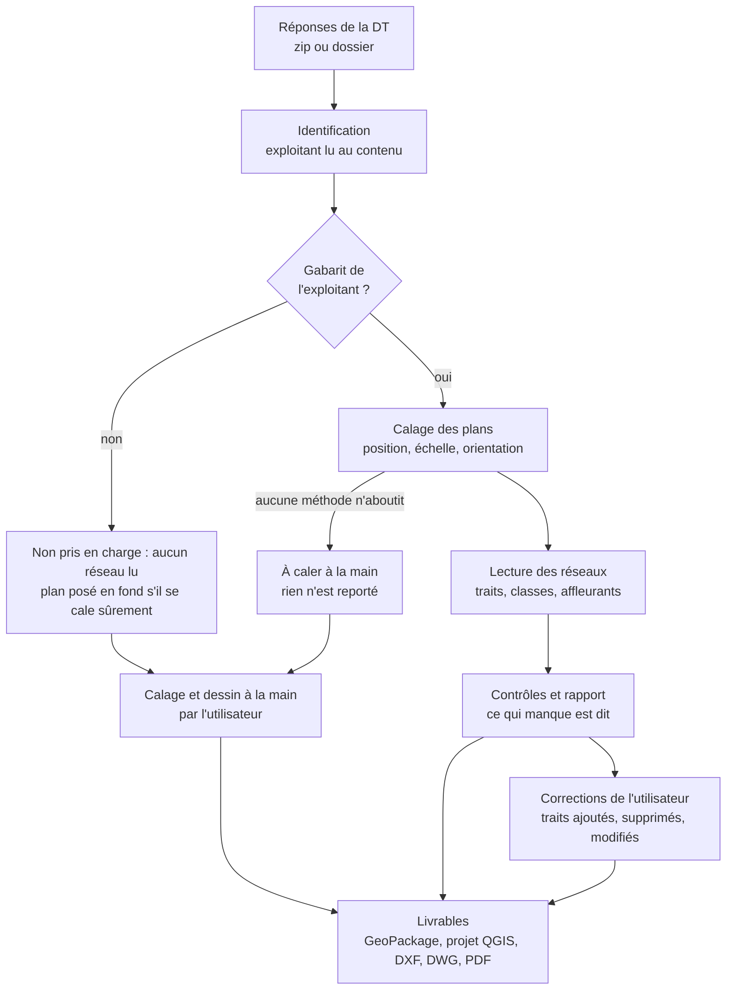
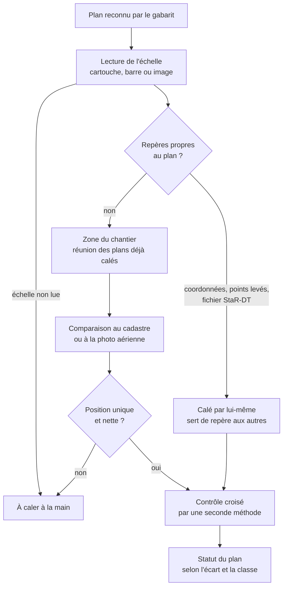
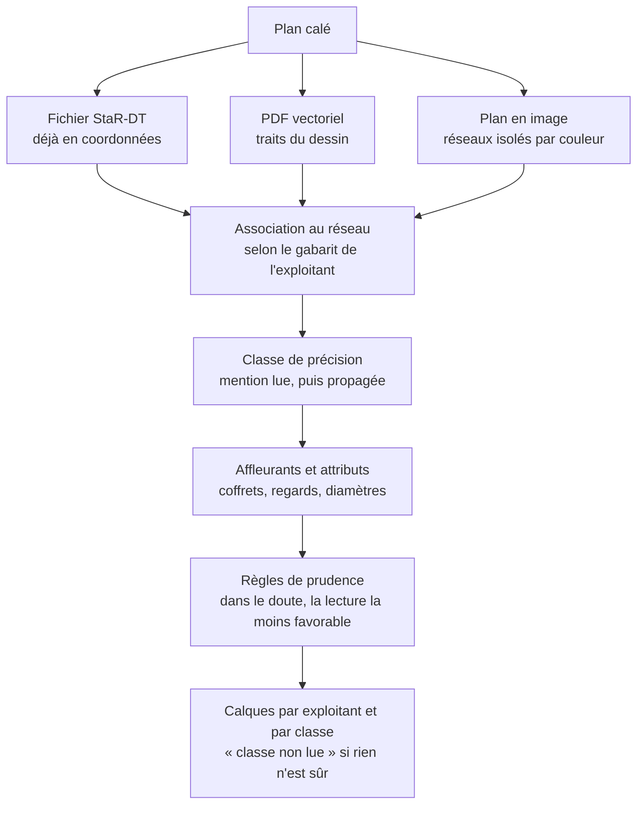

# Comment fonctionne E-ReportDT

E-ReportDT transforme les réponses d'une DT/DICT en couches SIG et en plans DAO. Il ne devine rien : il applique
des gabarits, un par exploitant, qui lui disent comment lire les plans de cet exploitant. Sans gabarit, ou dans le
doute, il s'abstient et le dit. La même DT traitée deux fois donne le même résultat, et les plans ne quittent pas
le poste.

Document dérivé d'aide à la lecture des réseaux : il peut contenir des erreurs. Seuls les plans des réponses aux DT/DICT des exploitants font foi.

## Le parcours d'une DT

Sans gabarit, aucun réseau n'est lu, mais le plan est posé en fond quand son échelle et son orientation se
contrôlent sur le cadastre ; sinon il reste « à caler à la main ». Dans l'extension, l'utilisateur cale lui-même un
plan par des points, puis y dessine les réseaux à la main. Sur un plan reporté, il complète le report : il ajoute des
traits, supprime ou modifie ceux du moteur, déclare une page vérifiée. Le report du moteur n'est jamais modifié : les
corrections sont gardées à part, appliquées aux seuls livrables (l'origine est dans les données), dites au rapport et
reprises au traitement suivant. L'utilisateur peut les envoyer à l'auteur, avec les seules pages concernées du plan,
pour améliorer l'outil.

## Le calage d'un plan

Caler un plan, c'est trouver où il est, à quelle échelle et dans quelle orientation. Les plans qui portent leurs
propres repères passent d'abord ; ils situent le chantier pour les autres.

Une position n'est acceptée que si elle ressemble assez à la référence, si elle est nettement meilleure que la
seconde, si la ressemblance chute dès qu'on s'en écarte, et si les différentes parties du plan s'accordent.

| Statut | Ce qu'il veut dire |
|---|---|
| calé ≤ 10 cm | écart mesuré compatible avec la classe A |
| calé, précision non démontrée | le plan est posé, sans preuve de sa précision au niveau de la classe |
| à vérifier | calé avec un doute : écart élevé ou contrôle discordant |
| à caler à la main | aucune méthode n'a abouti : rien n'est reporté de ce plan |

L'écart annoncé mesure la cohérence du calage, pas une précision garantie sur le terrain.

## La lecture des réseaux

Règles de prudence : un réseau n'est jamais annoncé aérien s'il peut être souterrain, ni dans une classe plus
précise que ce que le plan écrit ; un trait que le gabarit n'explique pas est signalé, pas interprété.
